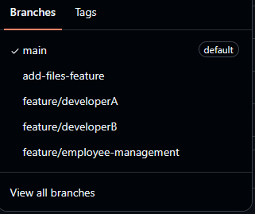
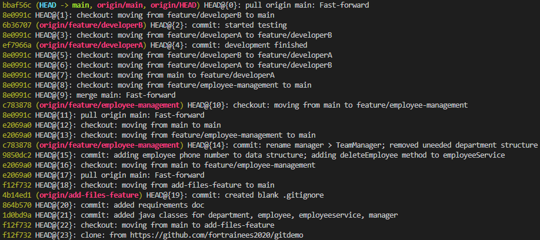
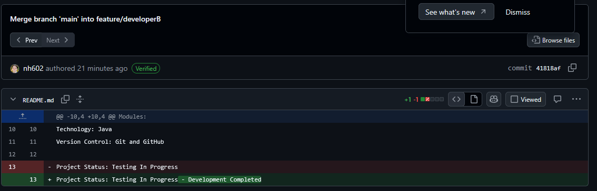
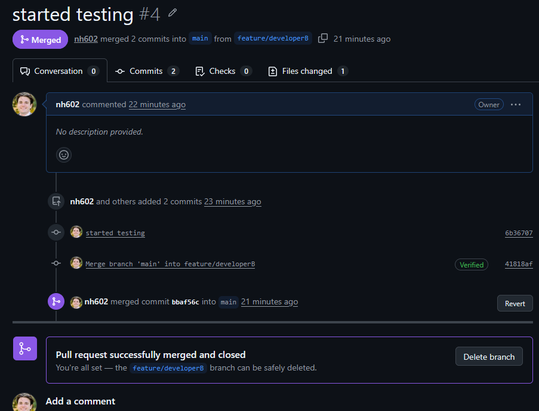

URL: https://github.com/nh602/gitdemo

# Submission
this is my submission for the assignment.

You can see my branches on my remote; here's a screenshot. 

This git log shows the command history i followed for my commits and merges.

Here you can see the change I made to resolve the merge conflict. I ensured that the edits were on the same line so that after I merged developerA the developerB merge wasn't able to merge without conflict. I resolved it in the github UI.

Here you can see the merge request after I merged. You can see the extra commit in this 'Merge branch main' is where i resolved the merge conflict.

# Questions and Answers
**How do you unstage a file without deleting it?**
You can run `git restore --staged <filename>`

**How do you discard uncommitted changes in a modified file?**
`git restore <filename>`

**How do you compare two commits?**
You can run `git diff <commit1> <commit2>`

**How do you delete a remote branch?**
You can run `git push origin --delete <branch-name>` or delete it in the webui.

**How do you create and push a Git tag named v1.0?**
You can run `git tag v1.0` followed by `git push origin v1.0`

**How do you revert a previously committed change?**
You can run `git revert <commit-hash>`

**What is the difference between git fetch and git pull?**
`git fetch` downloads changes from the remote without merging them into the current branch. `git pull` fetches the changes and then merges or rebases them into the current branch.

**What can happen when two developers push to the same branch?**
The first push succeeds, while the second push may be rejected if it is not based on the latest remote commit. The developer must fetch and integrate the remote changes before pushing again.